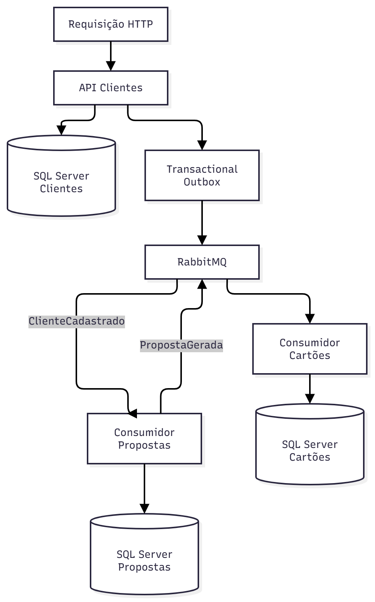

# Paraná Banco — Microsserviço de Cadastro de Clientes

## Diagrama de arquitetura

O fluxograma abaixo apresenta a comunicação assíncrona entre os três microsserviços, utilizando RabbitMQ e bancos de dados independentes.



O arquivo [editável no draw.io](arquitetura-parana-banco.drawio) também está disponível neste repositório.

Microsserviço responsável pelo cadastro, validação e consulta de clientes, desenvolvido em **.NET 10**, com **ASP.NET Core, Entity Framework Core, SQL Server, RabbitMQ e MassTransit**.

Este projeto faz parte de uma arquitetura de três microsserviços independentes:

- **Clientes:** cadastra clientes e publica eventos.
- **Propostas:** consome eventos de cadastro e gera propostas de crédito.
- **Cartões:** consome propostas geradas e emite cartões de crédito.

## 1. Responsabilidades

- Cadastrar clientes por meio de uma API REST.
- Validar CPF, e-mail e campos obrigatórios.
- Impedir o cadastro duplicado de CPF.
- Persistir os dados no SQL Server.
- Consultar clientes pelo identificador.
- Publicar o evento `ClienteCadastrado` no RabbitMQ.
- Utilizar Transactional Outbox para aumentar a confiabilidade da publicação dos eventos.

## 2. Arquitetura

O projeto está organizado em cinco camadas/projetos:

| Projeto | Responsabilidade |
|---|---|
| `ParanaBanco.Clientes.Domain` | Entidade Cliente, validações e Value Objects CPF e Email |
| `ParanaBanco.Clientes.Application` | Casos de uso, DTOs, interfaces e contrato de evento |
| `ParanaBanco.Clientes.Infrastructure` | Entity Framework Core, repositórios, MassTransit e Outbox |
| `ParanaBanco.Clientes.API` | Controllers, endpoints REST e configuração da aplicação |
| `ParanaBanco.Clientes.UnitTests` | Testes unitários com xUnit e Moq |

A separação busca manter as regras de negócio independentes dos detalhes de infraestrutura.

## 3. Tecnologias

- .NET 10 e C#
- ASP.NET Core Web API
- Entity Framework Core 10
- SQL Server LocalDB
- RabbitMQ 4
- MassTransit 8.5.7
- Docker Compose
- xUnit e Moq
- OpenAPI / Swagger UI

## 4. Regras de negócio

### Cadastro de clientes

O cadastro exige:

- Nome obrigatório.
- CPF válido, com verificação dos dígitos verificadores.
- E-mail válido.
- CPF único na base de clientes.

O CPF é normalizado para conter somente dígitos e o e-mail é normalizado antes da persistência.

Quando um CPF já está cadastrado, o caso de uso lança a exceção `ClienteJaCadastradoException`.

A API trata os erros de cadastro retornando **HTTP 409 Conflict** quando o CPF já está cadastrado e **HTTP 400 Bad Request** para argumentos inválidos. Erros inesperados permanecem sujeitos ao tratamento padrão do ASP.NET Core.

## 5. Pré-requisitos

Para execução local no Windows:

- .NET SDK 10
- SQL Server LocalDB
- Docker Desktop com Docker Compose
- Ferramenta `dotnet-ef` compatível com EF Core 10

O SQL Server LocalDB é utilizado diretamente no Windows. O RabbitMQ é executado em contêiner Docker.

## 6. Iniciar o RabbitMQ

Na raiz deste repositório, execute:

```powershell
docker compose up -d
```

O arquivo `docker-compose.yml` configura o RabbitMQ com:

| Configuração | Valor |
|---|---|
| Imagem | `rabbitmq:4-management` |
| Porta AMQP | `5672` |
| Painel de gerenciamento | `http://localhost:15672` |
| Usuário local | `guest` |
| Senha local | `guest` |
| Virtual host | `/` |

O contêiner possui volume persistente para armazenar os dados do RabbitMQ.

As credenciais apresentadas são exclusivas do ambiente de desenvolvimento local.

## 7. Configuração do banco de dados

A conexão com o banco de dados é configurada em:

`ParanaBanco.Clientes.API/appsettings.Development.json`

Exemplo:

```json
{
  "ConnectionStrings": {
    "ClientesDb": "Server=(localdb)\\MSSQLLocalDB;Database=ParanaBancoClientes;Trusted_Connection=True;TrustServerCertificate=True;"
  }
}
```

O banco de dados utilizado pelo microsserviço é `ParanaBancoClientes`.

Para outros ambientes, a connection string pode ser sobrescrita pela variável de ambiente `ConnectionStrings__ClientesDb`.

## 8. Como executar

Na raiz do repositório:

**Restaurar as dependências:**

```powershell
dotnet restore ParanaBanco.Clientes.slnx
```

**Aplicar as migrations:**

```powershell
dotnet ef database update --project ParanaBanco.Clientes.Infrastructure --startup-project ParanaBanco.Clientes.API --context ClientesDbContext
```

**Iniciar a API:**

```powershell
dotnet run --project ParanaBanco.Clientes.API
```

No perfil HTTP utilizado durante o desenvolvimento, a API fica disponível em:

`http://localhost:5013`

A interface Swagger UI está disponível em:

`http://localhost:5013/swagger`

## 9. Endpoints REST

### POST /api/v1/clientes

Cadastra um cliente.

Exemplo de requisição:

```http
POST http://localhost:5013/api/v1/clientes
Content-Type: application/json
```

```json
{
  "nome": "Cliente Exemplo",
  "cpf": "12345678909",
  "email": "cliente@example.com"
}
```

Em caso de sucesso, retorna HTTP 201 com os dados do cliente cadastrado.

Exemplo de resposta:

```json
{
  "id": "bec66c0e-d2ba-4673-a114-f97b9cb0eec4",
  "nome": "Cliente Exemplo",
  "cpf": "12345678909",
  "email": "cliente@example.com",
  "criadoEm": "2026-11-17T15:15:48.608218Z"
}
```

### GET /api/v1/clientes/{id}

Consulta um cliente pelo identificador.

Exemplo:

```http
GET http://localhost:5013/api/v1/clientes/bec66c0e-d2ba-4673-a114-f97b9cb0eec4
```

Retornos:

- **200 OK:** cliente encontrado.
- **404 Not Found:** cliente inexistente.

## 10. Mensageria e Transactional Outbox

Após o cadastro, o microsserviço publica o evento:

`ParanaBanco.Clientes.Application.Events.ClienteCadastrado`

O contrato contém:

- `EventId`
- `ClienteId`
- `Nome`
- `Cpf`
- `Email`
- `OcorridoEm`

### Transactional Outbox

A publicação utiliza o **MassTransit EF Core Bus Outbox**.

O objetivo é persistir o cliente e registrar a mensagem de saída na mesma transação do banco de dados.

O mecanismo utiliza as tabelas:

- `OutboxMessage`
- `OutboxState`
- `InboxState`

Um processo de entrega do MassTransit encaminha as mensagens pendentes ao RabbitMQ quando o transporte está disponível.

Isso reduz o risco de perda de eventos quando ocorre uma indisponibilidade temporária do broker.

### Comportamento durante indisponibilidade

Foi realizado um teste local com o RabbitMQ interrompido:

1. O RabbitMQ foi parado.
2. A API de Clientes permaneceu disponível.
3. Um novo cadastro foi persistido.
4. O evento ficou registrado no Outbox.
5. Após o retorno do RabbitMQ, a mensagem pendente foi processada pelo mecanismo de entrega.

Esse comportamento não implica garantia de processamento exatamente uma vez em todos os serviços. Os consumidores também precisam tratar reentregas e duplicidades.

## 11. Testes automatizados

O projeto utiliza xUnit e Moq.

Para executar:

```powershell
dotnet test ParanaBanco.Clientes.slnx
```

Os testes abrangem validações de domínio e casos de uso de cadastro e consulta de clientes.

**Última execução local em 17/11/2026:**

- 30 testes executados.
- 30 testes aprovados.
- Nenhuma falha.

## 12. Fluxo completo de integração

O fluxo de crédito é iniciado neste microsserviço:

1. A API de Clientes recebe um cadastro.
2. O cliente é validado e persistido.
3. O evento `ClienteCadastrado` é registrado no Outbox e publicado no RabbitMQ.
4. Propostas consome o evento e calcula o score simulado.
5. Propostas publica `PropostaGerada`.
6. Cartões consome o evento e emite os cartões permitidos.
7. As APIs disponibilizam consultas aos dados persistidos em seus respectivos bancos.

Cada microsserviço mantém seu próprio banco de dados.

## 13. Decisões técnicas e limitações

- Utilização de .NET 10 para todos os projetos.
- Separação entre Domain, Application, Infrastructure e API.
- Uso de Value Objects para validação de CPF e e-mail.
- SQL Server LocalDB para desenvolvimento no Windows.
- RabbitMQ em Docker para comunicação assíncrona.
- MassTransit Bus Outbox para reduzir riscos de perda de eventos.
- Contratos de eventos definidos localmente nos serviços consumidores, evitando referências diretas entre repositórios.
- Tratamento de erros de cadastro diretamente no controller, com possibilidade de evolução futura para um tratamento global utilizando ProblemDetails.
- Ausência de autenticação e autorização, por não fazerem parte do escopo funcional implementado neste desafio.

## 14. Repositórios relacionados

- [Propostas de Crédito](https://github.com/elainetec2/parana-banco-propostas)
- [Cartões de Crédito](https://github.com/elainetec2/parana-banco-cartoes)

**Repositório atual:** [Paraná Banco — Clientes](https://github.com/elainetec2/parana-banco-clientes)
